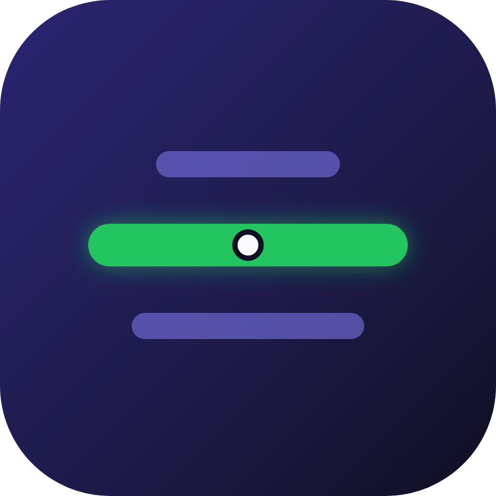

# GaSaMaRi - 가사마리

<p align="center">
  
</p>

Spotify에서 지금 재생 중인 곡의 가사를 음악 싱크에 맞춰 화면 중앙에 한 줄씩 띄워주는 앱입니다.
웹 브라우저뿐 아니라 Android와 iOS 모바일 앱(Capacitor 기반 네이티브 셸)에서도 바로 이용할 수 있습니다.

재생 중인 곡의 앨범 아트 색상에 맞춰 배경 분위기가 실시간으로 바뀌며, Three.js WebGL 셰이더와 블러 효과로 가사가 매끄럽게 전환됩니다.

## 주요 기능

- Spotify 재생 상태 실시간 추적 (`progress_ms` 기준 타임스탬프 동기화)
- 화면 중앙에 현재 가사 한 줄만 집중 표시
- Three.js WebGL 셰이더 기반 텍스트 연출 (저사양 환경이나 `prefers-reduced-motion` 설정 시 블러 텍스트로 자동 대체)
- 앨범 아트 대표 색상을 분석해 적용하는 동적 배경 테마
- `syncedlyrics`를 이용한 LRC 가사 검색 및 로컬 디스크 캐싱
- 가사 싱크 미세 조정 (±500ms 단위)
- 멀티 플랫폼 지원: 웹(Next.js)과 모바일(Android / iOS 네이티브 셸)
- 안전한 Spotify OAuth 2.0 (PKCE) 인증: 웹 세션 쿠키 및 모바일 시스템 브라우저 딥링크(`gasamari://callback`) 핸드오프

## 기술 스택

| 영역      | 기술                                                                              |
| --------- | --------------------------------------------------------------------------------- |
| Frontend  | Next.js 16, React 19, TypeScript, Tailwind CSS v4, Framer Motion, Three.js        |
| Mobile    | Capacitor 8 (Android / iOS 네이티브 셸)                                           |
| Backend   | Python 3.11+, FastAPI, syncedlyrics, uv                                           |
| Auth      | Spotify OAuth 2.0 + PKCE (HttpOnly 쿠키, 일회용 핸드오프 코드 기반 네이티브 인증) |
| Monorepo  | pnpm workspaces                                                                   |
| Container | Docker, Docker Compose                                                            |

## 사전 요구사항

- Node.js 20 이상
- pnpm 9 이상 (`corepack enable && corepack prepare pnpm@latest --activate`)
- Python 3.11 이상
- [uv](https://docs.astral.sh/uv/) (Python 패키지 및 가상환경 관리자)
- [Spotify Developer Dashboard](https://developer.spotify.com/dashboard)에 등록한 앱
- (모바일 빌드 시) JDK 21, Android Studio / Xcode

## Spotify 앱 설정

1. [Spotify Developer Dashboard](https://developer.spotify.com/dashboard)에서 새 앱을 만듭니다.
2. **Redirect URI** 목록에 아래 주소를 빠짐없이 등록합니다 (Spotify 인증은 등록된 주소와 한 글자만 달라도 실패합니다):
   - `http://localhost:3000/api/auth/callback/spotify`
   - `http://127.0.0.1:3000/api/auth/callback/spotify`
   - 프로덕션: `https://gsmr.homin.dev/api/auth/callback/spotify`
3. 앱의 **Client ID**와 **Client Secret**을 확인합니다.
4. 주의: Client Secret이 외부에 공개된 적이 있다면 대시보드에서 반드시 재발급받으세요.

> [!NOTE]
> 등록 위치: 대시보드 로그인 → 앱 선택 → **Settings** → **Redirect URIs**에 주소 입력 후 **Add** → 하단 **Save**.
> 모바일 앱(Capacitor)도 시스템 브라우저에서 인증을 마친 뒤 서버가 `gasamari://callback` 딥링크로 일회용 핸드오프 코드를 전달하므로, Spotify 대시보드에는 HTTPS 주소만 등록하면 됩니다.

## 설치 및 실행

### 1. 저장소 클론 및 패키지 설치

```bash
git clone <repository-url>
cd gasamari
pnpm install
```

### 2. 환경 변수 설정

**웹 프론트엔드** (`apps/web/.env.local`):

```env
SPOTIFY_CLIENT_ID=your_spotify_client_id
SPOTIFY_CLIENT_SECRET=your_spotify_client_secret
SPOTIFY_REDIRECT_URI=http://localhost:3000/api/auth/callback/spotify
API_BASE_URL=http://127.0.0.1:8000
```

**백엔드 API** (`apps/api/.env`):

```env
LYRICS_CACHE_DIR=./cache/lyrics
CORS_ORIGINS=http://localhost:3000
```

루트의 `.env.example` 및 각 앱의 예시 파일도 함께 참고할 수 있습니다.
`API_BASE_URL`은 서버 전용 환경 변수입니다. 브라우저는 Next.js의 `/api/lyrics`를 호출하고, Next.js 서버가 백엔드 FastAPI로 요청을 전달합니다.

### 3. 백엔드 가상환경 및 패키지 동기화

```bash
cd apps/api
uv sync
```

`uv sync`를 실행하면 지원하는 Python 버전을 확인해 `.venv`를 만들고 필요한 라이브러리를 한 번에 설치합니다.

### 4. 개발 서버 실행

루트 디렉터리에서 웹과 백엔드를 동시에 실행할 수 있습니다:

```bash
pnpm dev
```

서버를 따로 띄우려면 각각 실행합니다:

```bash
# 터미널 1: 웹 프론트엔드 (http://localhost:3000)
pnpm dev:web

# 터미널 2: 백엔드 API (http://localhost:8000)
pnpm dev:api
```

### 5. 기본 사용 흐름

1. 브라우저로 [http://localhost:3000](http://localhost:3000)에 접속합니다.
2. **Connect Spotify** 버튼을 눌러 로그인합니다.
3. Spotify 앱(PC, 모바일 어디든 무관)에서 음악을 재생합니다.
4. 화면 중앙에 음악 진행 시간에 맞춘 가사가 나타납니다.
5. 가사 싱크가 어긋나면 화면 하단의 싱크 조정 버튼(±500ms)으로 맞출 수 있습니다.

## 모바일 앱 (Android / iOS)

Capacitor 8 기반 네이티브 셸입니다. 앱 이름은 **GaSaMaRi**, 패키지 ID는 **`dev.homin.gasamari`** 입니다.

Next.js의 서버 사이드 렌더링과 API 라우트(쿠키 기반 OAuth 및 가사 프록시)를 그대로 활용하기 위해, 네이티브 셸이 프로덕션 웹(`https://gsmr.homin.dev`)을 불러와 표시합니다. 인증 토큰과 시크릿은 서버에서만 처리하며 앱 패키지 내부에는 민감 정보를 포함하지 않습니다.

모바일 로그인 시 시스템 브라우저를 띄워 인증을 진행하며(Google 로그인 등 지원), 인증 완료 후 서버가 발급한 일회용 코드(2분 유효)를 딥링크(`gasamari://callback`)로 전달받아 웹뷰의 HttpOnly 쿠키로 교환합니다.

### 모바일 빌드 사전 요구사항

- macOS 환경 (iOS 빌드 시 Xcode 필수)
- Android Studio 및 Android SDK (Android 빌드 시)
- **JDK 21** (Capacitor 8 Gradle 권장 환경):
  ```bash
  brew install openjdk@21
  export JAVA_HOME=$(/usr/libexec/java_home -v 21)
  export ANDROID_HOME=$HOME/Library/Android/sdk
  ```

### 모바일 관련 명령어

루트 디렉터리에서 바로 실행할 수 있습니다:

```bash
pnpm mobile:sync     # 네이티브 프로젝트에 설정 및 웹 에셋 동기화
pnpm mobile:android  # Android Studio 프로젝트 열기
pnpm mobile:ios      # Xcode 프로젝트 열기
```

직접 빌드하거나 특정 서버 주소를 바라보게 설정할 때(`apps/web` 디렉터리 기준):

```bash
cd apps/web

# 로컬 개발 서버나 사설망 IP를 바라보게 동기화할 때
CAP_SERVER_URL=http://192.168.0.10:3000 pnpm cap:sync

# 디버그 빌드
pnpm build:android   # 결과물: android/app/build/outputs/apk/debug/app-debug.apk
pnpm build:ios       # iOS 시뮬레이터용 빌드 검증
```

### 앱 스토어 출시 전 확인 사항

- [x] 정식 앱 아이콘 적용 (Current Line 디자인 — iOS/Android/Web 반영 완료, 원본은 `apps/web/icon-proposals/`)
- [ ] 스플래시 이미지 적용 (현재 기본 템플릿 에셋 상태)
- [ ] Android 릴리스 키스토어 생성 및 서명 설정 (키스토어 파일과 비밀번호는 저장소에 커밋하지 않음)
- [ ] Apple Developer Team 서명 및 App Store Connect 앱 등록 (`dev.homin.gasamari`)
- [ ] 웹 최신 버전 배포 (네이티브 셸이 운영 서버 URL을 로드하므로 웹 변경분이 먼저 배포되어 있어야 앱에 반영됩니다)

## 프로젝트 구조

```text
gasamari/
├── apps/
│   ├── web/                     # Next.js 프론트엔드 및 Capacitor 네이티브 셸
│   │   ├── app/                 # App Router 페이지 및 API 라우트
│   │   ├── components/          # UI 및 WebGL/애니메이션 컴포넌트
│   │   ├── hooks/               # useNowPlaying, useSyncedLyrics 등 훅
│   │   ├── lib/                 # Spotify 연동, LRC 파서, 팔레트 추출 유틸
│   │   ├── capacitor.config.ts  # Capacitor 모바일 앱 설정
│   │   ├── native-shell/        # 오프라인 폴백용 최소 웹셸
│   │   ├── android/             # Android 네이티브 프로젝트
│   │   └── ios/                 # iOS 네이티브 프로젝트
│   └── api/                     # FastAPI 가사 검색 백엔드
│       ├── routes/              # /lyrics 엔드포인트
│       ├── services/            # syncedlyrics 호출 및 파일 캐시 관리
│       └── cache/               # 가사 캐시 저장소 (git 미포함)
├── docker-compose.yml           # 프로덕션 컨테이너 구성
├── PLAN.md                      # 구현 계획 및 설계 문서
├── AGENTS.md                    # 개발 및 협업 가이드
└── README.md
```

## 주요 API 명세

### 웹 프론트엔드 (Next.js)

| 메서드 | 경로                                | 설명                                                             |
| ------ | ----------------------------------- | ---------------------------------------------------------------- |
| GET    | `/api/auth/login`                   | Spotify OAuth 인증 시작                                          |
| GET    | `/api/auth/callback/spotify`        | Spotify 인증 콜백 처리 (웹 리다이렉트 또는 네이티브 딥링크 전달) |
| GET    | `/api/auth/native/exchange?code=`   | 네이티브 앱용 일회용 코드를 HttpOnly 세션 쿠키로 교환            |
| POST   | `/api/auth/logout`                  | 세션 쿠키 삭제 및 로그아웃                                       |
| GET    | `/api/auth/status`                  | 현재 로그인 인증 상태 조회                                       |
| GET    | `/api/spotify/now-playing`          | 현재 재생 중인 트랙 정보 및 진행 시간 조회                       |
| GET    | `/api/lyrics?track=&artist=&album=` | 가사 검색 요청 (백엔드 FastAPI 프록시)                           |

### 백엔드 (FastAPI)

| 메서드 | 경로                            | 설명                              |
| ------ | ------------------------------- | --------------------------------- |
| GET    | `/health`                       | 서버 상태 점검(헬스체크)          |
| GET    | `/lyrics?track=&artist=&album=` | LRC 동기화 가사 검색 및 캐싱 반환 |

## 주요 실행 스크립트

```bash
pnpm dev            # 웹과 API 동시 실행
pnpm dev:web        # Next.js 프론트엔드만 실행
pnpm dev:api        # FastAPI 백엔드만 실행 (uv run uvicorn)
pnpm build          # Next.js 프로덕션 빌드
pnpm lint           # 프론트엔드(ESLint) 및 백엔드(Ruff) 검사
pnpm mobile:sync    # 모바일 프로젝트 동기화
pnpm mobile:android # Android Studio 열기
pnpm mobile:ios     # Xcode 열기
```

## 컨테이너 배포 (Docker Compose)

Docker Compose로 전체 스택을 함께 띄울 수 있습니다.

루트 디렉터리의 `.env` 설정 예시:

```env
APP_URL=https://your-domain.com
SPOTIFY_CLIENT_ID=your_spotify_client_id
SPOTIFY_CLIENT_SECRET=your_spotify_client_secret
SPOTIFY_REDIRECT_URI=https://your-domain.com/api/auth/callback/spotify
API_BASE_URL=http://api:8000
CORS_ORIGINS=https://your-domain.com
```

실행:

```bash
docker compose up -d --build
```

- `API_BASE_URL`은 Docker 네트워크 내부에서 Next.js 컨테이너가 API 컨테이너를 호출할 때 사용하는 주소(`http://api:8000`)입니다. 외부에 노출할 필요가 없습니다.
- Spotify 대시보드에 등록한 Redirect URI와 환경 변수의 `SPOTIFY_REDIRECT_URI` 값이 정확히 일치해야 합니다.
- Docker 환경에서 `HOSTNAME=0.0.0.0`은 바인딩 주소이므로, 브라우저가 접근하는 OAuth 리다이렉트 주소로 지정하면 접속 오류가 발생합니다. 반드시 도메인이나 실제 접근 가능한 IP 주소를 지정하세요.

## 이용 시 참고 사항

- Spotify Web API의 재생 상태 폴링 간격(2초) 때문에 곡이 막 바뀌거나 재생 위치를 옮겼을 때 가사 싱크에 순간적인 차이가 생길 수 있습니다. 지속적으로 어긋날 때는 하단 싱크 보정 버튼을 활용할 수 있습니다.
- `syncedlyrics`에서 일치하는 동기화 가사를 찾지 못한 곡은 "Synced lyrics not found" 문구가 표시됩니다.
- 가사 확인(현재 재생 상태 읽기)은 Spotify 무료 및 프리미엄 계정 모두 지원합니다. 단, 곡 제어(스킵, 일시정지 등) 기능은 Spotify Web API 정책상 프리미엄 계정에서만 동작합니다.

## 라이선스

비공개 저장소입니다. 라이선스는 저장소 소유자에게 문의하세요.

## 관련 문서

- [PLAN.md](./PLAN.md): 구현 계획 및 상세 설계
- [AGENTS.md](./AGENTS.md): 개발 가이드 및 주의사항
- [Spotify Web API](https://developer.spotify.com/documentation/web-api)
- [syncedlyrics](https://github.com/moehmeni/syncedlyrics)
